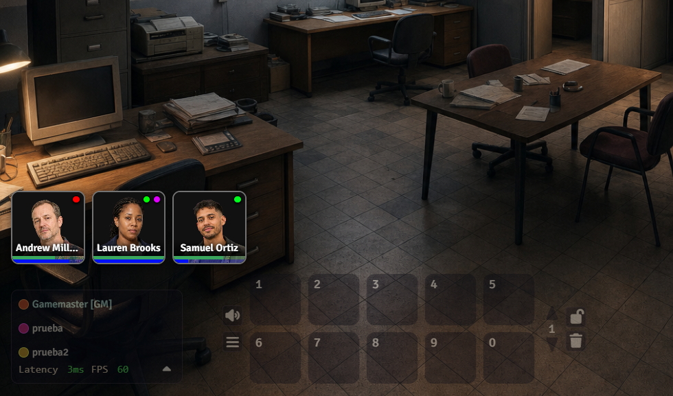

# Party Corner Portraits

Party Corner Portraits displays your party’s character portraits in a corner of Foundry VTT. The GM can configure their order, size, position, framing, names, colored markers, and resource bars linked to character data. Clicking a portrait opens its character sheet.

## Compatibility

| Module version | Foundry VTT |
| --- | --- |
| 1.3.0 | 11 |
| 2.4.0 | 13 |
| 3.2.0 | 14 |

## Installation

In Foundry VTT, open **Add-on Modules → Install Module** and use the appropriate manifest URL:

- Foundry VTT 11: `https://raw.githubusercontent.com/malatestaabrx/party-corner-portraits/main/manifests/module-v11.json`
- Foundry VTT 13: `https://raw.githubusercontent.com/malatestaabrx/party-corner-portraits/main/manifests/module-v13.json`
- Foundry VTT 14: `https://raw.githubusercontent.com/malatestaabrx/party-corner-portraits/main/manifests/module-v14.json`

Then enable **Party Corner Portraits** in your world and open **Game Settings → Configure Settings → Module Settings → Configure Portraits**.

## Source code

- `party-corner-portraits-v11/party-corner-portraits`: Foundry VTT 11 version.
- `party-corner-portraits-v13/party-corner-portraits`: Foundry VTT 13 version.
- `party-corner-portraits-v14/party-corner-portraits`: Foundry VTT 14 version.

## Bug reports and suggestions

Use the [issue tracker](https://github.com/malatestaabrx/party-corner-portraits/issues).

## Publishing releases to Foundry VTT

The repository includes a manual GitHub Actions workflow named **Publish release to Foundry VTT**. Add the package release token from the Foundry package management page as a repository Actions secret named `FOUNDRY_RELEASE_TOKEN`.

Run the workflow with **Validate without publishing** enabled first. If validation succeeds, run it again with that option disabled. Select Foundry 11, 13, or 14 to register the current release for that Foundry generation. Wait at least 60 seconds between requests.
